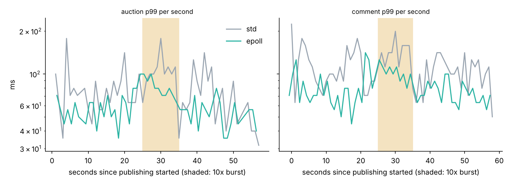

# RoomCast

A hot-room fan-out gateway in Go for live-room events (comments, gifts, battle scores, auction bids, moderation). Viewer connections live on edges; a job tier publishes each room event once per edge; edges fan out with a per-viewer, class-aware queue that drops comments before gift combos and never drops auction bids, battle scores or moderation deletes. Three edge builds share everything except the connection model: the standard library's goroutine-per-connection design, an epoll event loop written for this project, and CloudWeGo Netpoll, the event-loop library ByteDance built for this problem. The results below compare std and epoll; the Netpoll build passes the same transport test and is wired into `bench/run_all.sh`, but has not been benchmarked yet.

## Results (measured on one 2-vCPU VM)

Full tables: [`results/SUMMARY.md`](results/SUMMARY.md). Design and the degradation policy: [`docs/DESIGN.md`](docs/DESIGN.md). The edge runs pinned to one vCPU (`GOMAXPROCS=1`, `taskset -c 0`); publisher and viewer fleet share the other.

**Memory per idle connection** (18,000 viewers connected and joined, forced GC):

| build | goroutines | edge RSS per connection | of which goroutine stacks |
|---|---|---|---|
| std (reader + writer goroutine per connection) | 36,009 | 6.4 KiB | 4.0 KiB |
| epoll (own event loop) | 9 | **0.5 KiB** (12x less) | 0 |

**Fan-out under a 10x burst** (16,000 viewers, 2,455 in a hot room with a battle and an auction; 36 events/s per hot-room viewer at 1x, 10x for 10 s; two runs per build):

| | std | epoll |
|---|---|---|
| auction p99, 1x / 10x burst | 126 / 126 ms | 71 to 126 / **79 to 89 ms** |
| auction events within a 200 ms SLO during the burst | 99.96 to 100% | 100% |
| edge CPU per million delivered frames | 7.2 to 8.6 s | **4.9 s** (32 to 43% less) |
| frames delivered (60 s) | 5.1 to 6.4M | 8.8M |
| comments sampled away (per-viewer cap) | 5.8 to 6.8M | 4.2 to 4.3M |
| wrong auction or battle values at the end, moderation gaps | 0, 0 | 0, 0 |



The std build delivered fewer frames because it fell behind sooner: its fan-out lag crossed the degradation threshold and the edge cut the per-viewer comment rate, exactly as designed, while auction and battle frames stayed on time.

**Slow viewers** (2% read at 8 KB/s through a 4 KiB buffer): normal viewers' auction p99 stayed at 112 to 126 ms; slow viewers still got auction and battle values at p50 112 ms, p99 251 to 316 ms, with no viewer disconnected.

**Edge failure** (two edges, SIGKILL one holding 8,000 viewers, survivor admits 5,000 new connections/s): all 8,000 viewers resynced on the other edge within 1.7 s (p99, naive retry) to 3.2 s (max, jittered backoff), with zero wrong auction values and zero missing moderation events at the end. Jittered backoff that honours the edge's retry-after hint cut refused connection attempts by 74% (17,825 to 4,560).

## Things the benchmark caught

- **Writing per batch is a syscall storm.** The first epoll build wrote to every dirty connection after every published batch (200 batches/s x thousands of viewers): auction p50 was 4.5 s. A profile showed 78% of CPU in `write`. Fan-out now only queues and marks connections dirty; dirty connections are written at most every 20 ms (both builds), and under load more frames ride on each write. On loopback the sender's `write` also pays for the receiver's TCP processing, which inflates the per-frame cost on a single box.
- **Allocation churn in the queue.** Releasing each viewer's maps and comment ring after every drain meant reallocating them a few hundred times per second per viewer; keeping them for active viewers (idle viewers never allocate) cut CPU per frame by about a fifth.
- **Kernel buffers defeat app-level priority.** With default socket buffers, slow viewers (2 KB/s) saw auction values 22 to 32 s late (p99): they waited behind kilobytes of comments already written into the kernel, where nothing can be coalesced or reordered. Edge send buffers are now 16 KiB and a backed-up viewer gets only urgent classes, in 2 KiB writes, for 2 s after its last backup. A first version that left urgent mode after ten clean writes still showed p99 2.5 s at 8 KB/s (it flipped back and re-flooded); the time-based version gives p99 316 ms.

## What is here

```
proto/      wire format: length-prefixed frames, events, snapshots, zero-copy splitter
queue/      per-viewer class-aware queue (moderation FIFO, latest-value state, aggregated gifts, sampled comments)
evloop/     epoll event loop: SO_REUSEPORT listeners, non-blocking I/O, EPOLLOUT only under backpressure, write coalescing hook
edge/       edge core (room state, snapshots, admission, degradation levels, job link) + std, epoll and netpoll transports
job/        publisher: per-room sequence numbers, one stream per edge, membership-driven routing, open-loop scenario
loadgen/    viewer fleet on epoll loops: multi-source-IP dialing, per-class latency, gap detection and resync, reconnect policies, final-state verification
cmd/        rcedge, rcjob, rcload
bench/      run_all.sh (with the kernel settings it changes), plot.py
```

## Reproduce

```
bench/run_all.sh     # about 35 minutes with the netpoll arms; writes results/memory.jsonl, runs.jsonl, SUMMARY.md, figures
go test -race ./...
```

## What is not here

- **Connections per 8-vCPU / 32 GB box**: not measured. This VM allows 20,000 file descriptors per process, so one edge was tested up to 18,000 connections, and viewers, publisher and edge share two vCPUs. The per-connection numbers above are what scale; the ceiling on a real box is kernel socket memory and fan-out CPU, not the edge's heap.
- **Kafka**: the job tier generates events itself; in production it would consume them from Kafka (or the single-writer log from HotLedger). The edge-facing protocol is the same.
- **WebSocket and TLS**: raw TCP framing. WebSocket adds a per-message header and TLS adds per-connection state and CPU; neither changes the comparison between connection models.
- **Netpoll measurements**: `edge/netpoll.go` (Netpoll v0.7.0: Netpoll's pollers own the sockets, no goroutine per idle connection, one flusher goroutine per connection only while it has data) is built and tested, and `bench/run_all.sh` has netpoll arms for every experiment, but the 35-minute run that would put it in the tables was not done. Do not quote Netpoll numbers.
- **gnet** and a Hertz/WebSocket front end: not built; all builds speak raw TCP.
- **Multi-machine latency**: publisher, edge and viewers share one clock; across machines this needs synchronised clocks or echoed timestamps.
- The effect of a reconnect storm on the surviving edge's existing viewers was not consistent across runs (auction p99 in the 10 s after the kill varied from 63 to 224 ms in either policy), so no claim is made about it.

## Resume bullets (numbers from `results/`)

- Built RoomCast, a Go live-room fan-out gateway (edge / job tiers, per-room sequence numbers with gap repair, class-aware per-viewer queues: auction bids and battle scores coalesced but never dropped, gift combos aggregated, comments sampled) with goroutine-per-connection and from-scratch epoll event-loop edge builds (plus a CloudWeGo Netpoll build, not yet benchmarked).
- The event-loop edge held 18,000 connections at 0.5 KiB each (12x less than goroutine-per-connection) and, under a 10x battle-end burst to 16,000 viewers, kept 100% of auction events within a 200 ms SLO (p99 79 to 89 ms) at 32 to 43% less CPU per delivered message.
- After killing an edge holding 8,000 viewers, all reconnected and resynced within 3.2 s with zero lost auction state, and jittered backoff with server retry hints cut refused connection attempts by 74%.

## Interview defence

See `docs/DESIGN.md` section 9 (the Go netpoller, why goroutine-per-connection costs memory, head-of-line blocking, ordering per room). Also be ready for: why the writes are coalesced (syscalls per frame), why kernel buffers are kept small (priority only works on bytes still in your queue), and why admission sheds new connections before existing viewers degrade.
